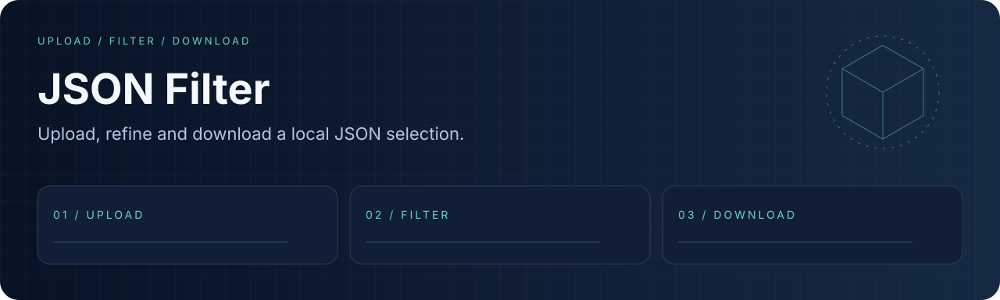
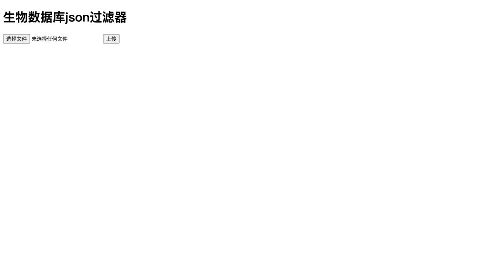

<div align="center">
  
  <h1>JSON Filter</h1>
  <p><strong>Upload, refine and download a local JSON selection.</strong></p>
  <p><a href="LICENSE"></a> <a href="docs/readme/validation.md"></a></p>
  <p><a href="#overview">Overview</a> · <a href="#quick-start">Quick start</a> · <a href="#workflow">Workflow</a> · <a href="#validation">Validation</a> · <a href="#documentation">Docs</a></p>
  <p><a href="README.en.md">English</a> · <a href="README.md">简体中文</a></p>
</div>

---

<a id="overview"></a>
## Overview

A small Go web tool for exact string filtering in JSON records. It listens on 127.0.0.1:8080 and serializes access to one shared local selection.

| Capability | What it provides |
| :--- | :--- |
| **Simple input** | A top-level results array of objects. |
| **Recursive matching** | Exact string matches inside objects and arrays. |
| **Honest output** | No-match replaces the selection with an empty array; rows are not duplicated. |

### Local interface



<a id="quick-start"></a>
## Quick start

```bash
git clone https://github.com/eust-w/json_filter.git
cd json_filter
go mod download
go run .
# Open http://127.0.0.1:8080/ and upload examples/sample.json.
```

<a id="workflow"></a>
## Workflow

```text
UPLOAD → FILTER → DOWNLOAD
```

```bash
go test -race ./...
go build .
```

<a id="validation"></a>
## Validation

```bash
go test -race ./...
go build .
```

Recorded environment and executed checks: [validation notes](docs/readme/validation.md).

| Area | Current boundary |
| :--- | :--- |
| Input | Use {"results":[{...}]}; invalid shapes return HTTP 400. |
| Download | The output is the selected array; other top-level fields are not preserved. |
| Users | Single-user local tool with a shared selection; it is not a multi-tenant service. |

<a id="documentation"></a>
## Docs

- [Sample input / 输入样例](examples/sample.json)
- [Regression tests / 回归测试](main_test.go)
- [Implementation / 实现](main.go)

## License and provenance

Original code and newly created demo assets are licensed under [Apache-2.0](LICENSE). Dependencies, models, datasets and external resources retain their terms; see [THIRD_PARTY_NOTICES.md](THIRD_PARTY_NOTICES.md).
